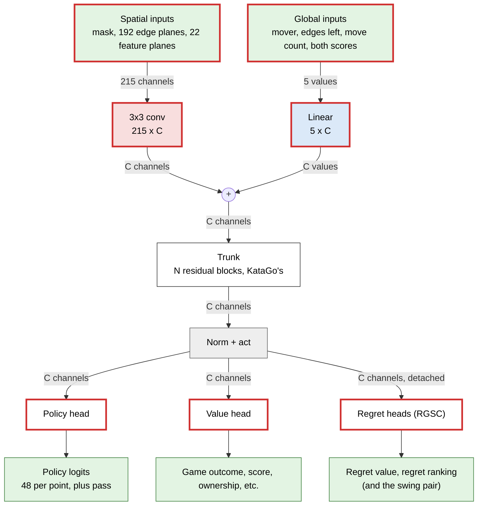
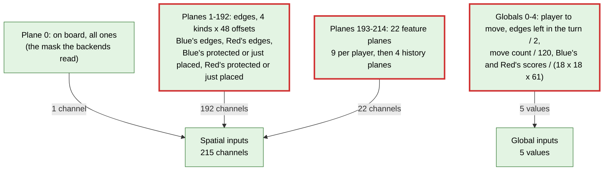
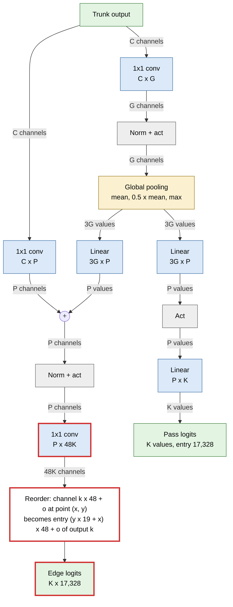
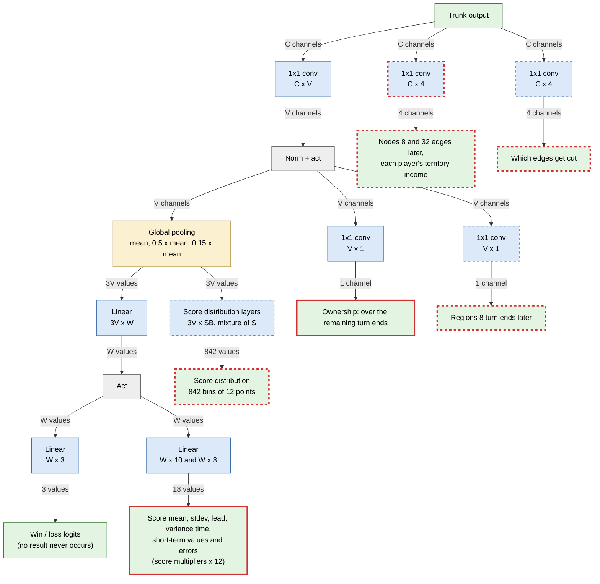
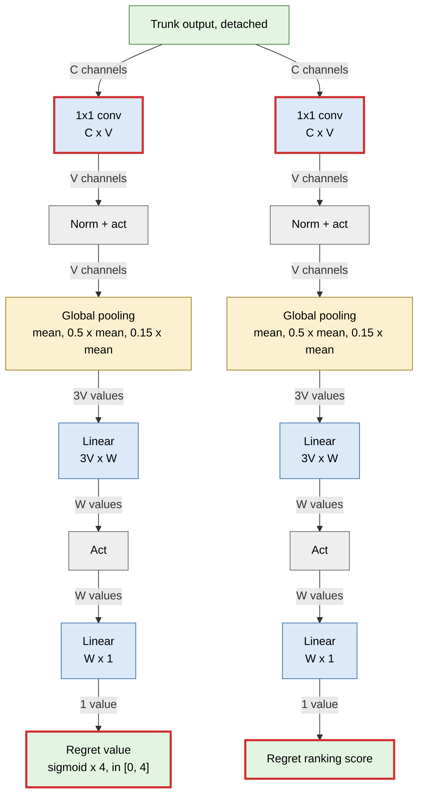

# The Enclosure network (V2): architecture and differences from KataGo

This describes the networks V2 trains (run `v2a`) and how they differ from KataGo's. Everything not listed as a
difference is KataGo's, as described in [docs/NetworkArchitectures.md](docs/NetworkArchitectures.md): the trunk, its
residual and global pooling blocks, the normalisation, the activation, and the shapes of the policy and value heads.
The reasons for each change are in [ENCLOSURE.md](ENCLOSURE.md) and in `games/enclosure/docs/decisions/` of the
Enclosure repository. This file is the picture.

* [Summary](#summary)
* [What differs from KataGo](#what-differs-from-katago)
* [Common structure](#common-structure)
  * [Inputs](#inputs)
  * [Trunk](#trunk)
  * [Policy head: one logit per edge](#policy-head-one-logit-per-edge)
  * [Value head and spatial targets](#value-head-and-spatial-targets)
  * [Regret heads (RGSC)](#regret-heads-rgsc)
* [Layout](#layout)
* [Where the parameters went](#where-the-parameters-went)

## Summary

| Size | Kind | Num params (C++) | KataGo's same size | Role in v2a |
|---|---|---|---|---|
| b10c128 | Convnet | 3,215,747 | 2,994,503 | Plays self-play (200/40 visits), with every exported model |
| b15c192 | Convnet | 10,249,927 | 9,930,951 | Trained on the same data, next to play |
| b6c96 | Convnet | (trainer: 1,178,765) | – | v2a's first network, until b10c128 took over (before the regret heads existed) |

For comparison, V1's network (`net1`, `net1b`: 128 channels × 8 blocks, JAX) has about 2.8M parameters
([games/enclosure/v1/README.md](https://github.com/abstractclass-org/engines/blob/ab141c99/games/enclosure/v1/README.md)).

Notes on the table:
* "Num params (C++)" is the engine's count when it loads the model (`selfplay.log`, "convnet, N params"). The
  trainer counts 3,215,811 and 10,250,007.
* Trained as model version 15 and exported as version 17, which carries the fork's extra outputs (below).
* KataGo's counts are from its table: g170 networks at model version 8 with a 5x5 initial convolution. If the
  current trainer built KataGo's b10c128 at version 15 (3x3), it would have about 2.96 M. See
  [Where the parameters went](#where-the-parameters-went).
* Both are version 15, Fixup, ReLU: KataGo's `b10c128` and `b15c192` configs as they stand, no nested bottleneck and
  no transformer.

## What differs from KataGo

In order of how much they change the network:

1. **The policy is over edges, not points.** A move is an edge from a point to one of 48 offsets within Chebyshev
   distance 3. Each policy output has 48 channels per point, so the board's policy is 19 x 19 x 48 = 17,328 logits,
   plus pass: 17,329 against Go's 362. Pass stays one logit per output. The head itself is KataGo's. Only its last
   1x1 convolution is 48 times wider.
2. **The inputs.** 215 spatial planes (Go: 22) and 5 global values (7 with V9's playout doubling advantage; Go: 19), in absolute colours, with the player to
   move as a global input. 192 of the planes are edges, 48 offsets each for four kinds of edge. The initial
   convolution grows from 22 x C to 215 x C, about 8% of b10c128's parameters.
3. **The targets in KataGo's spatial heads change their meaning.** The heads keep their shapes and slots, except that
   the future-position head has 4 channels instead of 2:

   | KataGo's head | Go target | Enclosure target |
   |---|---|---|
   | Ownership (V x 1) | final ownership | mean region ownership over the remaining turn ends |
   | Future positions (C x 2) | stones 8 and 32 moves later | nodes 8 and 32 edges later |
   | Future positions, channels 3-4 (new) | none | each player's territory income per point |
   | Seki (C x 4) | seki / dead stones | which edges get cut before the game ends |
   | Scoring (V x 1) | final area | regions 8 turn ends later |

4. **Two new heads, RGSC's regret value and regret ranking** (Tsai et al., ICLR 2026), in KataGo's value-head shape
   on the detached trunk. They read the trunk and never train it.
5. **Score constants scaled for Enclosure's scores.** Scores stay in points, but every constant KataGo tuned to Go's
   point scale is multiplied by 12 (output multipliers 20 to 240, Huber deltas). The score distribution keeps 842
   bins, each 12 points wide (Go: 1). Go's score-parity term is a no-op (its vector is zero).

The following are **not** differences, though they could look like them:
- **The board size is always 19 x 19.** The board-size scalings in KataGo's pooling become constants. The value
  head's three pools are then the mean, 0.5 x the mean and 0.15 x the mean. The trunk's and policy head's pools are
  the mean, 0.5 x the mean and the max. The mask (input channel 0) is all ones.
- **Symmetries act on positions, not on the backend's pixels.** An edge's image re-anchors at its lower end, so a
  symmetry is not a permutation of pixels and channels. The evaluator fills the inputs from the image position, and the
  backend always runs the identity. This does not change the network.

## Common structure

Same conventions as KataGo's document: each layer node shows its weight shape as input width x output width, and each
edge is labelled with the width of the data on it ("channels" per board point, "values" for the whole board). Colours
mark the kind of layer: green for inputs and outputs, red for 3x3 convolutions, blue for 1x1 convolutions and linear
layers, yellow for global pooling, gray for normalisation and activation. **A thick red border marks a part that
differs from KataGo's.**



### Inputs

Input version V8 (`NNInputs::fillRowV8`, and the Python reference is the Enclosure repository's `net.input_planes`).



- **Edge planes.** An edge is set at both ends: at its lower end (the canonical edge's first point) in the plane of
  its offset, and at its upper end in the plane of the opposite offset.
- **Feature planes, per player:**
  - 0: the player's nodes.
  - 1: points inside its enclosed regions.
  - 2: points on its edges that the opponent cannot cut.
  - 3-5: points that it reaches in exactly 1, 2 or 3 hops.
  - 6: points that it cannot reach.
  - 7: the turn-safe plane: points of its edges that the opponent cannot cut in its next turn (V1: held ground).
  - 8: empty (V1: openings).

  The 4 history planes mark the edges placed 2 to 5 turns ago. The observation's edge planes already carry the
  current and the previous turn.
- **Absolute colours.** Plane k describes Blue for k = 0, and the mover is a global input. KataGo's Go inputs are
  relative to the mover.

### Trunk

KataGo's, unchanged: pre-activation residual blocks of two 3x3 convolutions, some of them global pooling blocks.
See [Regular residual block](docs/NetworkArchitectures.md#regular-residual-block) and
[Global pooling residual block](docs/NetworkArchitectures.md#global-pooling-residual-block). Fixup initialisation,
ReLU, and one norm at the end of the trunk.

### Policy head: one logit per edge

KataGo's policy head, with a last convolution that produces 48 channels per policy output instead of one. Version 15
trains 6 policy outputs (K = 6: policy, opponent's policy, soft policies, optimistic and the like), and the export
keeps 2, as upstream.



The move's index is the policy entry: `(y x 19 + x) x 48 + offset`, with pass last at 17,328. The point (x, y) is the
edge's source: the mover's node that it is drawn from, or, for an edge between two of the mover's nodes, its lower
end.
Offsets run dx, then dy, each from -3 to 3, skipping (0, 0):

```
 dy \ dx   -3  -2  -1   0   1   2   3
   -3       0   7  14  21  27  34  41
   -2       1   8  15  22  28  35  42
   -1       2   9  16  23  29  36  43
    0       3  10  17   .  30  37  44
    1       4  11  18  24  31  38  45
    2       5  12  19  25  32  39  46
    3       6  13  20  26  33  40  47
```

In C++ the NHWC output is read in place: channel k x 48 + offset at a point is entry k's logit for that edge. The
CUDA backend's buffers and decode hold 48 channels per output, and the Eigen backend decodes the blocks the same way.
The policy is now gathered on the GPU for the legal moves only ([speed.md](../games/enclosure/docs/decisions/speed.md), "The
policy gathered on the GPU"). This changes the backend, not the network.

### Value head and spatial targets

KataGo's value head with its outputs in Enclosure units. The pooled trunk feeds the outcome, the score values and
the score distribution, and per-point heads give the spatial targets. Dashed parts are outputs that the search does not
read:

- the score distribution, which is for training only and not exported, as in KataGo.
- three auxiliary heads (the future positions and income, the cut edges, and the regions). The export writes them as
  raw outputs (model version 17, aux version 1).



- **Outcome.** Win, loss and no-result logits as KataGo's. The fork never sets no-result. Its rules take KataGo's
  area-scoring branch, which sets that output to zero, so win and loss share the probability.
- **Scores** are in points of the final margin (red minus blue, as `finalWhiteMinusBlackScore`). The multipliers that
  keep outputs near unit scale are 12 times KataGo's (240 for score mean, stdev and lead). The variance-time
  multiplier is scaled by game length (x 0.366, provisional). Loss weights and Huber deltas follow the same rule
  (ENCLOSURE.md, "Score scale").
- **Score distribution.** KataGo's 842 bins (2 x (361 + 60)), each 12 points wide, centred at 12 x (bin - 421 + 0.5):
  margins up to ±5,052. The parity term (Go's komi parity) is kept as a no-op.
- **Ownership (exported)** is the Enclosure ownership target: per point, the mean over the remaining turn ends of +1 inside the mover's regions,
  -1 inside the opponent's, 0 otherwise.
- **Auxiliary heads** (in KataGo's slots, see ENCLOSURE.md, "Spatial targets"):
  - Future positions, channels 1-2: the mover's and opponent's nodes 8 and 32 edges later, KataGo's loss.
  - Future positions, channels 3-4 (added later): each player's territory income per point (its enclosed area
    in the unit square around the point, averaged over the remaining turn ends). Binary cross-entropy, weighted as
    ownership. The idea comes from the ownership target of iviazovetskyi's public bot.
  - Seki slot: per point on an edge, whether no edge there, one of the mover's or one of the opponent's is cut
    before the game ends. Cross-entropy over the points on edges.
  - Scoring slot: region occupancy at the 8th turn end later (both players), KataGo's area loss.

### Regret heads (RGSC)

Two heads added for Regret-Guided Search Control (see `games/enclosure/docs/decisions/rgsc.md`). The
paper does not describe its heads, and the authors' code copies its own value head for them, so V2 copies KataGo's
value-head shape (a named deviation). Both read the trunk **detached**, as the authors' do: their losses train the
heads only, never the trunk.



- **Targets.** A position's regret is the paper's Eq. 2: the mean, over the game's positions from it to the end, of
  (the selected move's search value - the outcome)². The ranking loss is the authors' grouped list-wise loss, in
  groups of 32 rows.
- **Use.** Both are exported. The C++ search reads them at every self-play evaluation: the ranking picks each game's
  candidate start position for the regret buffer, and the value estimates its regret. They have no part in move
  choice or in the gauntlet.
- **Pooling.** The heads use KataGo's value-head pooling (`KataValueHeadGPool`): a mean and two board-size scalings
  of it. On the 19 x 19 board these are 0.5 x and 0.15 x the mean, so there is no max. The class's docstring and
  rgsc.md say "mean, scaled mean, max". The code is as drawn here.
- **The swing pair** (`swing_heads`, since 2026-10-11). RGSC's second source has its own two heads, a swing value and
  a swing ranking, with the same shape and the same detached input. Their target is the value swing: the mean of
  the squared steps of the search value from the position to the end of the game (the result is the value after the
  last move), each step weighted by 0.9 to the power of its distance, times 50, capped at 4. The
  export writes the four heads in this order: regret value, regret ranking, swing value, swing ranking. A binary
  built before reads only 0 or 2 heads, so it refuses a model with 4. The pair adds 2 x 11,969 parameters to b10c128
  (the table below counts the first pair only).

## Layout

The columns are KataGo's ([Layout](docs/NetworkArchitectures.md#layout)). Heads P / G / V / W are the widths in the head
diagrams. SB / S are the hidden width and the mixture count of the score distribution.

| Size | Model version | Initial conv | Blocks | Global pooling blocks | Trunk C | Pooling G in trunk | Heads P / G / V / W | SB / S | Policy outputs (training) | Activation, norm |
|---|---|---|---|---|---|---|---|---|---|---|
| b10c128 | 15 (exported as 17) | 3x3, 215 x 128 | 10 regular | 2 (blocks 5, 8) | 128 | 32 | 32 / 32 / 32 / 80 | 64 / 6 | 6 x 48 channels | ReLU, Fixup |
| b15c192 | 15 (exported as 17) | 3x3, 215 x 192 | 15 regular | 2 (blocks 7, 12) | 192 | 64 | 32 / 32 / 32 / 96 | 80 / 8 | 6 x 48 channels | ReLU, Fixup |

The block counts and widths are KataGo's configs of the same names. The 3x3 initial convolution is that of KataGo's current
trainer. Its g170 networks of these sizes used 5x5.

## Where the parameters went

b10c128's 3,215,811 trainer parameters by part (`train0.log`), against KataGo's b10c128 config built by the same
trainer for Go:

| Part | Enclosure | KataGo, same trainer (computed) | Why |
|---|---|---|---|
| Initial conv + global linear | 247,680 + 640 | 25,344 + 2,432 | 215 x 128 x 3 x 3 and 5 x 128, against 22 and 19 inputs |
| Trunk (10 blocks, final norm) | 2,897,728 | 2,897,728 | Unchanged |
| Policy head | 23,840 | 14,816 | The last conv: 32 x 288 (6 outputs x 48) against 32 x 6 |
| Value head | 21,985 | 21,729 | Future positions: 4 channels instead of 2 |
| Regret heads | 23,938 | none | 2 x 11,969 |
| **Total** | **3,215,811** | **2,962,049** | |

The trunk is 90% of ours and 98% of KataGo's. Of the 253,762 extra parameters, the input layer accounts for
220,544, the regret heads for 23,938, the wider policy for 9,024 and the two future-position channels for 256.
